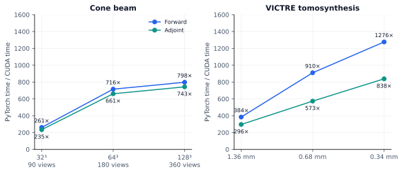
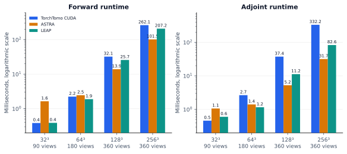
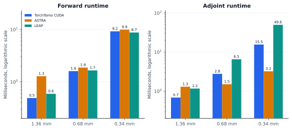
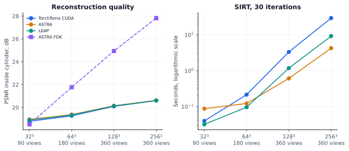
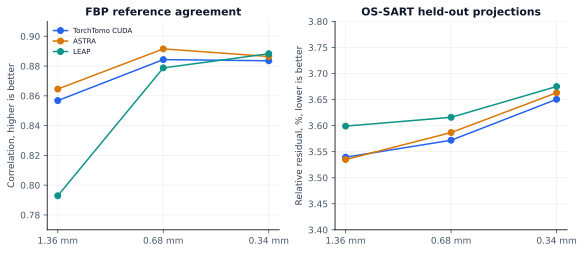

# Cone beam and tomosynthesis figures

Download and open [report.html](report.html) in a browser for the interactive
report. It is self-contained and includes eight tables and seven figures across
the cone beam, tomosynthesis, and CUDA versus PyTorch tabs.

The figures summarize the recorded RTX 2080 Ti measurements from 20 October 2026:

- [Cone beam JSON](../cone/cone-comparison.json) and [tables](../cone/tables.md).
- [Tomosynthesis JSON](../dbt/cone-comparison.json) and [tables](../dbt/tables.md).
- [Cone beam PyTorch comparison](../cone/pytorch-path/cone-comparison.json).
- [Tomosynthesis PyTorch comparison](../dbt/pytorch-path/cone-comparison.json).

TorchTomo uses the CUDA kernels released in 0.5.0, measured at commit `47cb25b`
with source hash `4ca1fd5e9653`; 0.5.0 differs only in its version string. The software provenance and benchmark
settings are recorded in each JSON file. The figures show aggregate measurements;
reconstruction slice images were not saved with these results.

| Measurement | Cone beam | Tomosynthesis |
| --- | --- | --- |
| Forward and adjoint runtime | [SVG](cone-runtime.svg) | [SVG](dbt-runtime.svg) |
| Reconstruction quality | [SVG](cone-quality.svg) | [SVG](dbt-quality.svg) |
| Operator agreement and dot test | [SVG](cone-agreement.svg) | [SVG](dbt-agreement.svg) |

CUDA versus PyTorch operator speedup:

Cone beam forward and adjoint runtime, with logarithmic vertical axes:

Tomosynthesis forward and adjoint runtime, with logarithmic vertical axes:

Cone beam reconstruction quality and SIRT runtime:

Tomosynthesis FBP correlation and OS-SART held-out residual:

Relative L2 differences use TorchTomo as the reference without a fitted scale.
Dot-test departure is the absolute difference from a ratio of one, expressed as
a percentage. GPU memory from PyTorch's allocator does not include ASTRA and LEAP
working buffers. The report marks PyTorch out-of-memory cases explicitly.
